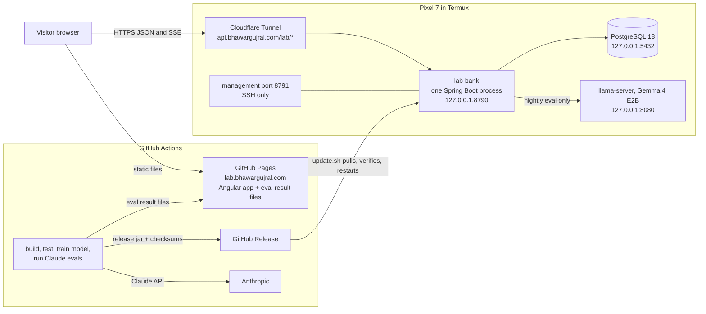

# Plan 2: Shared platform and phone hosting

Both projects run on one small fake bank. This file covers everything they share: the repo, the bank's data, API conventions, the Angular shell, security, CI, and how it all runs on the Pixel 7. Read `README.md` in this folder first for the decisions and the feasibility results.

Working names used throughout (Bhawar may rename them): repo `fincrime-lab`, fake bank "Sandbox Bank", site `lab.bhawargujral.com`, API `api.bhawargujral.com/lab/v1`.

## 1. System at a glance



What runs where:

| Piece | Where | Why there |
|---|---|---|
| Angular site, eval result files, API docs | GitHub Pages | Free, always up, same pattern as the portfolio |
| Payment screening, game, case APIs | Phone | Always on, no cloud bill, real latency numbers |
| PostgreSQL | Phone | Needs to sit next to the app |
| Model training (gradient-boosted trees) | Mac and GitHub Actions | Needs Python and CPU the phone should not spend |
| Claude eval runs | GitHub Actions | The API key stays in GitHub secrets, never on the phone |
| Phone-model eval runs | Phone, at night | That model only exists there |

## 2. Technology choices

| Area | Choice | Reason |
|---|---|---|
| Language | Java 21 | The phone's Termux package is OpenJDK 21.0.13 (installed 2026-11-16). The Mac has only JDK 17 today, so install JDK 21 there |
| Framework | Spring Boot 4.x, latest stable | His daily stack. The agent should take the current version from start.spring.io |
| Shape | One deployable jar, modular monolith, module boundaries checked by Spring Modulith tests | The phone has room for one JVM, not five. This is a decision to defend in interviews, so write it up as an ADR |
| Database | PostgreSQL 18 | Available in Termux; same engine in local Docker and in CI through Testcontainers |
| Migrations | Flyway | Standard, plain SQL |
| Data access | `JdbcClient` with explicit SQL | Money code reads better with visible SQL, and it uses less memory than Hibernate. Bhawar can switch to JPA if he wants that on show |
| Events between modules | Spring application events with the Modulith event publication registry (an outbox table) | Gives the outbox pattern without Kafka, which does not fit on the phone |
| Web | Spring MVC on Tomcat, virtual threads on | Simple, and virtual threads keep the thread count low |
| Rate limiting | Bucket4j, in memory | No Redis needed |
| Metrics | Micrometer, percentile histograms | Feeds the public latency numbers |
| API docs | springdoc-openapi generates `openapi.json` at build time; published on the site | No Swagger UI running on the phone |
| Frontend | Angular, latest stable, standalone components and signals, Tailwind CSS, Angular CDK | Decision: Angular in its own site. Bank postings ask for Angular and the portfolio already shows React |
| Charts | Chart.js | Small and enough |
| Frontend tests | The Angular CLI's default unit runner, plus Playwright for two end-to-end flows | Playwright is on his CV |
| Model training | Python via `uv`, LightGBM | Mac has Python 3.14 and uv. Pin the training environment to a Python version that has LightGBM wheels |
| Model serving | A small pure-Java tree scorer written in this repo | Native libraries such as ONNX Runtime are built for glibc Linux and will not load in Termux |
| Claude access | Official Anthropic Java SDK, `com.anthropic:anthropic-java` (3.3.0 was current in the reference used; check for a newer one) | Do not use OpenAI-compatible shims for Claude |
| Phone model access | Plain `java.net.http` client to llama-server's chat endpoint | It is a different provider with a different API |
| Build | Maven with the wrapper | Mac has Maven 3.9.11 |

## 3. Repository layout

```
fincrime-lab/
  README.md                 what it is, live links, architecture picture, numbers
  docs/
    architecture.md
    decisions/              ADR-0001-modular-monolith.md, ADR-0002-pure-java-scorer.md, ...
    plans/                  these plan files move here
  backend/
    pom.xml
    src/main/java/com/bhawargujral/lab/
      platform/             ids, money, SimClock, rate limiting, problem details, visitor id
      bankcore/             customers, accounts, transactions, ledger, risk list
      simulator/            world generator, background payment stream, scenario injectors
      screening/            features, rules, tree scorer, decision policy, payments API
      game/                 attempts, sandbox world, leaderboard
      cases/                alerts, cases, evidence queries, reviews
      investigator/         evidence pack, model clients, agent loop, report, verifier
      evals/                dataset, runner, graders, result files
    src/main/resources/db/migration/   Flyway SQL
    src/test/...
  web/                      Angular app
  ml/                       pyproject.toml, train.py, export_model.py, parity fixtures
  deploy/phone/             runit run files, update.sh, postgresql.conf, tunnel snippet, soak.sh
  .github/workflows/        backend.yml, web.yml, ml.yml, evals.yml, release.yml, pages.yml
```

Module rules, enforced by a test: `screening`, `game`, `cases`, `investigator` and `evals` may depend on `bankcore` and `platform`. `game` may depend on `screening`. `investigator` may depend on `cases`. `evals` may depend on `investigator` and `cases`. Nothing depends on `game` or `evals`.

## 4. The fake bank (bankcore and simulator)

Everything is synthetic. No real person, bank or account appears anywhere.

### 4.1 Tables

| Table | Key columns | Notes |
|---|---|---|
| `customer` | id, public_id, display_name, segment (RETAIL, STUDENT, SENIOR, SMALL_BUSINESS), birth_year, occupation, stated_income_cents, kyc_notes, risk_rating, onboarded_at | `kyc_notes` carries the facts that explain benign look-alikes, such as "parents abroad fund tuition" |
| `account` | id, public_id, customer_id, type, opened_at, status, balance_cents | Balance is updated in the same database transaction as the ledger entries |
| `external_party` | id, public_id, name, kind (PERSON, BUSINESS, EXCHANGE, FOREIGN_BANK), country | Counterparties outside the bank |
| `txn` | id, public_id, posted_at, type, account_id, counter_account_id, external_party_id, direction, amount_cents, location, memo, scenario_id | Every posted money movement of any type. This is what the AML side reads |
| `ledger_entry` | id, txn_group, account_ref, amount_cents signed | Double entry: the entries of one group sum to zero |
| `payment_request` | id, public_id, idempotency_key unique, source_account_id, payee ref, amount_cents, memo, channel, session_signals jsonb, origin (BACKGROUND, GAME, INTERNAL), requested_at_sim, requested_at_wall, decision, model_score, model_version, rules_fired, reasons jsonb, screening_micros, total_micros, txn_id | Instant payments that went through screening, whether or not money moved |
| `risk_list` | party ref, reason, added_at | Accounts with earlier fraud reports |
| `scenario` | id, kind, label, params jsonb, seed | **Ground truth.** Never returned by a public endpoint and never placed in a prompt |
| `event_publication` | created by Spring Modulith | The outbox |

Money is always a `long` count of cents in CAD. Internal keys are `bigint`; anything shown outside uses a prefixed random public id such as `pay_7Hq2…`, `att_…`, `case_…`.

### 4.2 Simulated time

One `SimClock` owns "now" for the fake world. All feature windows and reports use transaction time from that clock, never the wall clock. This lets the game jump "three days later" instantly and makes every run reproducible. Wall-clock time is recorded separately, only for latency measurements.

### 4.3 The world generator

A seeded generator builds the world once: about 2,000 customers, 2,600 accounts and 12 months of history, roughly 600,000 transactions. It is the same code path on the phone, the Mac and CI, so the same seed gives the same world everywhere.

- Personas drive behaviour: salary dates, rent, groceries, bill payments, seasonal patterns, business cash cycles.
- Scenario injectors add labelled activity: scam payments (for screening) and laundering patterns plus benign look-alikes (for AML). Each writes a `scenario` row and tags its transactions.
- Command: `java -jar lab-bank.jar generate-world --seed 42`. Expected to take a minute or two on the phone; measure it.

### 4.4 The background payment stream

While at least one visitor has the Live page open, the simulator sends two to four payments a second through the real payment pipeline, including the database commit. With no viewers it stops, so the phone is not kept busy for nobody. The share of scam payments in this stream is raised to about 3% so visitors see blocks happen; the page says so.

### 4.5 Ledger

Every posted payment writes balanced entries. A scheduled job recomputes the sum per group and per account and exposes "books balance: yes or no" on the stats endpoint. A property-based test proves that any sequence of payments, retries and restarts leaves the books balanced.

## 5. API conventions

- Base URL: `https://api.bhawargujral.com/lab/v1`. The app's context path is `/lab`, so the existing hostname and certificate are reused and no DNS change is needed for the API.
- JSON only. Timestamps are ISO-8601 UTC. Money is an integer number of cents plus `"currency": "CAD"`.
- Errors use `application/problem+json` (RFC 9457) with a stable `type` and a human `detail`.
- Lists are paged with `?page=` and `?size=` (max 100) and return `items`, `page`, `size`, `total`.
- Writes that create something accept an `Idempotency-Key` header. A repeat with the same key returns the original result.
- Live data uses Server-Sent Events, which already works through the tunnel for the chatbot.
- Rate limits return `429` with `Retry-After`. Limits are per visitor IP, read from Cloudflare's `CF-Connecting-IP` header. That header is trusted only because the app listens on localhost and the tunnel is the only way in.
- CORS allows `https://lab.bhawargujral.com`, and `http://localhost:4200` in the dev profile only.
- No login in version 1. A visitor id is a random UUID the browser makes and stores; the server treats it as untrusted and uses it only to group "your attempts".

Shared endpoints (each project's own endpoints are in its plan):

| Method and path | Purpose |
|---|---|
| `GET /health` | status, app version, model version, simulated time |
| `GET /stats` | headline numbers for the home page: attempts, share stopped, fake dollars protected, legit payments interrupted, screening p50 and p99, books balance flag |
| `GET /openapi.json` | generated API description |

Management endpoints live on a second port, `127.0.0.1:8791`, that the tunnel never routes. They are reachable only over SSH: actuator health and metrics, plus custom operations (`world-generate`, `stream`, `model-reload`, `game-export`, `evals-run`, `leaderboard-hide`).

## 6. Angular site

Routes:

| Route | Page |
|---|---|
| `/` | Lab home: two large tiles (play the scam game, open the AML desk), a strip of live numbers, a link back to the portfolio |
| `/play`, `/play/result/:id` | The game and a shareable result |
| `/live` | Live payment decisions and the latency chart |
| `/screening` | How screening works: pipeline, rules, model card, version history |
| `/cases`, `/cases/:id` | Case queue and case view with report, evidence and replay |
| `/scorecard`, `/scorecard/runs/:id` | The eval scorecard and one run in detail |
| `/about` | Architecture, limitations, disclaimers, repo link |

Design direction:

- It should feel like a bank's operations console: calm, dense where data is dense, generous everywhere else. Light and dark themes.
- Reuse the portfolio's font and brand colour so the two sites feel related. The agent should read the tokens in the portfolio's `src/index.css` before choosing colours.
- `/play` is designed phone-first, because recruiters open links on phones.
- Every page that needs the phone has an offline state, like the chatbot's: a clear banner and whatever still works from static files. The scorecard works fully without the phone.
- Every page carries a one-line footer: "Sandbox Bank is fictional. All customers and transactions are generated."

Hosting: GitHub Pages from the `fincrime-lab` repo with the custom domain `lab.bhawargujral.com`. That needs one DNS record in Cloudflare (a CNAME from `lab` to `bhawargujral.github.io`, with the same proxy setting the main site's records use) and the domain set in the repo's Pages settings.

## 7. Security and abuse

| Risk | Control |
|---|---|
| The phone also holds banking apps for his parents' accounts | Recommended before the first deploy: move those apps to another phone. If they stay: nothing new listens on a public port, the app binds to localhost, and the tunnel exposes only `/lab/*` |
| Oversized or malformed input | Bean Validation on every request body, an 8 KB body limit, strict enums, bounded amounts and lengths |
| Flooding | Per-IP and global rate limits; the game allows 30 attempts an hour per IP; SSE connections capped at 50 |
| Abusive nicknames on the leaderboard | 2 to 16 characters, letters, digits and spaces only, run through a block list (port the word lists the guestbook already uses), and a management command to hide an entry |
| Prompt injection | In version 1 no visitor text ever reaches a language model. The memo field feeds keyword flags only |
| Secrets | The Claude API key exists only as a GitHub Actions secret. The phone holds no token of any kind for this project |
| Someone else's code running on the phone | No self-hosted GitHub runner. The phone only pulls a release jar and checks its SHA-256 before running it |
| Ground truth leaking | `scenario` data is excluded from every public DTO by a test that scans responses for scenario fields |
| Dependencies | Dependabot and CodeQL on the public repo |

No file uploads anywhere. No real personal data anywhere.

## 8. Running on the phone

### 8.1 What was measured on 2026-11-16

| Check | Result |
|---|---|
| RAM | 7.5 GB total. About 1.4 to 1.7 GB "available" with the chatbot, guestbook and tunnel running. Swap is 77% to 98% used, so memory is tight |
| Disk | 16 GB free |
| Java | OpenJDK 21.0.13 installed from Termux; all four live services kept running |
| Scoring speed | A 300-tree, depth-6 model scores one payment in 8.5 microseconds on the phone (p99 13 microseconds), about 117,000 a second on one core |
| HTTP round trip on the phone | With the JDK's built-in test server and client both on the phone: median 1.1 ms, p99 3.1 ms |
| JVM memory | About 160 MB resident for the small test program with a 256 MB heap cap. A Spring Boot app will be larger; not yet measured |
| PostgreSQL | Package available (18.6), not yet installed |

### 8.2 Memory budget

| Process | Expected resident memory |
|---|---|
| `lab-bank` JVM | 350 to 450 MB (to be measured) |
| PostgreSQL | 60 to 120 MB |
| Existing chat gateway, guestbook, tunnel | about 70 MB |
| llama-server model | up to 3.1 GB when it is answering; the system reclaims it when idle |

JVM flags to start from:

```
-Xms128m -Xmx320m -XX:+UseSerialGC -XX:MaxMetaspaceSize=128m
-XX:ReservedCodeCacheSize=64m -Xss512k -XX:+ExitOnOutOfMemoryError
```

Spring settings: bind to `127.0.0.1:8790`, management on `127.0.0.1:8791`, virtual threads on, database pool of 4, JMX off. Build with Spring AOT and a CDS archive to shorten start-up; target under 15 seconds on the phone.

PostgreSQL settings: `listen_addresses = '127.0.0.1'`, `shared_buffers = 32MB`, `work_mem = 2MB`, `max_connections = 20`, `max_wal_size = 256MB`, `fsync` and `synchronous_commit` left on.

### 8.3 Services

Two new runit services beside the existing ones, in `$PREFIX/var/service/`:

- `lab-postgres`: runs `postgres -D $PREFIX/var/lib/postgresql`.
- `lab-bank`: runs `java <flags> -jar ~/lab/current/lab-bank.jar`, with settings from `~/lab/lab.env` (mode 600). It waits for PostgreSQL to accept connections before starting.

Both restart on crash and start on boot through the Termux:Boot setup already in place.

### 8.4 Tunnel

Add one rule to `~/.cloudflared/config.yml` above the catch-all rule for `api.bhawargujral.com`, after backing the file up:

```yaml
  - hostname: api.bhawargujral.com
    path: ^/lab(/.*)?$
    service: http://127.0.0.1:8790
```

Then `sv restart pixel-tunnel`. The chatbot and guestbook drop for a few seconds while it restarts.

### 8.5 Releases and updates

1. A tag on `main` makes GitHub Actions build `lab-bank-<version>.jar` and `SHA256SUMS` and attach both to a GitHub Release.
2. On the phone, `~/lab/bin/update.sh <version>` downloads both over HTTPS (the repo is public, so no token), checks the SHA-256, unpacks into `~/lab/releases/<version>/`, points `~/lab/current` at it, and runs `sv restart lab-bank`.
3. The script polls `/lab/v1/health` for 60 seconds. If it does not come up healthy, the script points `current` back at the previous release and restarts again.
4. Bhawar runs the script over SSH from the Mac. Automating the trigger can come later.

### 8.6 Backups

The world is reproducible from its seed, so only visitor-created data needs keeping: game attempts, leaderboard, reviews. A nightly `pg_dump` of those tables goes to `~/backups/`, seven kept.

### 8.7 Soak test before anything goes public

Same idea as the chatbot's soak test. Run for 24 hours with the background stream on at two payments a second and a script asking the chatbot a question every minute. Pass means all of:

- no service restarted or was killed (check `sv status` uptimes);
- chatbot speed stays within 10% of its usual 7.4 to 8 tokens a second;
- `lab-bank` resident memory stays under 450 MB;
- `free -m` "available" never drops under 600 MB;
- battery temperature stays under 42°C;
- screening p99 stays under 1 ms and end-to-end payment p99 under 25 ms.

If it fails on memory, in order: remove unused apps and the live wallpaper from the phone; lower the heap to 256 MB; replace PostgreSQL with an embedded database; as a last resort, move `lab-bank` and PostgreSQL to a free cloud VM and keep the phone for the chatbot and the phone-model evals. The Angular site only needs its API base URL changed for that.

## 9. CI and CD

| Workflow | Trigger | What it does |
|---|---|---|
| `backend.yml` | every push and PR | `mvn verify`: unit tests, property tests, Modulith boundary test, integration tests on PostgreSQL through Testcontainers |
| `web.yml` | every push and PR | lint, unit tests, production build, Playwright against a mocked API |
| `ml.yml` | changes under `ml/` or the feature code, and manual | generate the training set from the seed, train, export the model, run the Java parity test, attach metrics |
| `evals.yml` | PRs touching `investigator/` or prompts, weekly, and manual | run the Claude contestants, compare with the baseline, comment on the PR, publish result files. Detail in `04-aml-investigator.md` |
| `release.yml` | version tag | build the jar and checksums, create the GitHub Release |
| `pages.yml` | push to `main` | build the Angular site with the latest eval result files and deploy to Pages |

Required GitHub secret: `ANTHROPIC_API_KEY`. Nothing else.

## 10. Local development

- `docker compose up` starts PostgreSQL 18.
- `./mvnw spring-boot:run -Dspring-boot.run.profiles=dev` starts the API on `localhost:8790` with a small world (200 customers) generated on first start.
- `npm start` in `web/` serves the site on `localhost:4200` against the local API.
- A `fake-llm` profile returns canned model answers so the investigator can be developed with no API calls and no phone.

## 11. Order of work for the platform (milestone M1)

1. Create the repo with the layout above, the Maven wrapper, an empty Angular app, and the three basic workflows.
2. `platform` and `bankcore`: money and id types, Flyway schema, ledger with its property test.
3. `simulator`: personas and the legit-behaviour generator, with a determinism test (same seed, same checksum of the world).
4. `/health`, `/stats`, problem details, rate limiting, CORS.
5. Angular shell: routes, theme, layout, offline banner, home page reading `/stats`.
6. Phone: install PostgreSQL, add the two services, add the tunnel rule, deploy with `update.sh`.
7. DNS record and Pages for `lab.bhawargujral.com`.

Done when `https://api.bhawargujral.com/lab/v1/health` answers from the phone, `https://lab.bhawargujral.com` loads and shows live numbers, and a first 2-hour soak passes.
